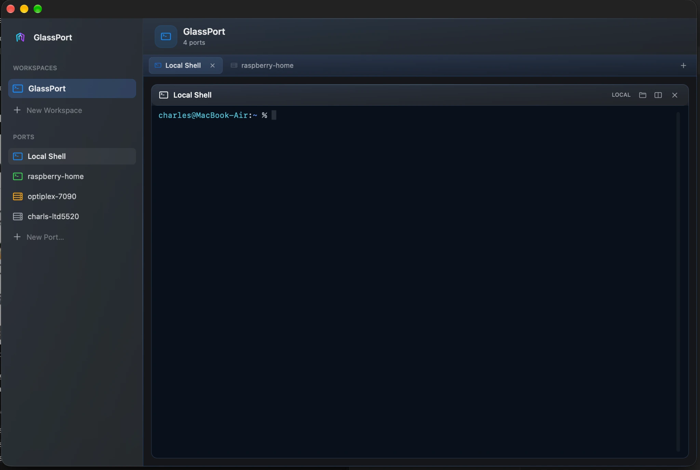
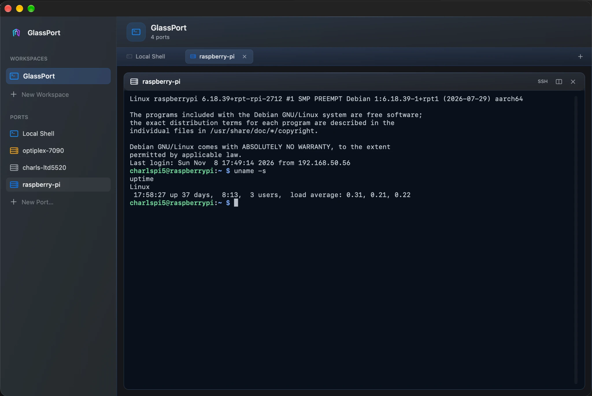
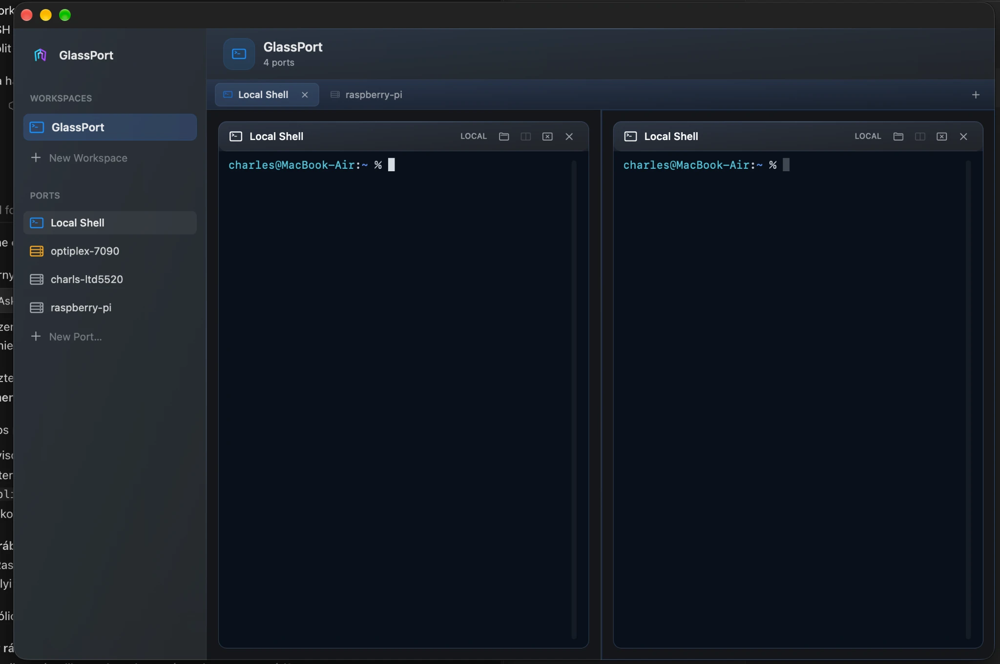

[← Apple developer profile](https://github.com/Charles-drZ)

# GlassPort — Native macOS developer workspace

**A focused Mac application for local shells, SSH connections and terminal sessions.**

**Swift · AppKit · SwiftTerm · PTY · system OpenSSH · XCTest**

GlassPort organizes local and remote development around persistent Workspaces, semantic Ports and live terminal Sessions — instead of a collection of unrelated windows.

The implementation is private. This showcase describes the accepted native macOS foundation, important engineering decisions and current limitations.

## Real macOS application screenshots

These captures show GlassPort running on macOS on **November 8, 2026**. They are real application screenshots, not generated mockups or independently reproducible source-code evidence.

**01 — Workspace overview.** The AppKit workspace sidebar, local shell, discovered ports, and tab layout.

**02 — Remote SSH terminal.** An interactive Raspberry Pi SSH session with command output.

**03 — Companion split.** One tab displays **two independent Local Shell sessions**. The split action duplicates the current Port; this is **not** a mixed Local/SSH split.

Screenshots illustrate visible product behavior, not a release claim or complete QA acceptance.

## Product experience

The accepted product includes:

- **Workspaces** with creation, selection, renaming and deletion;
- **Local and SSH terminals** using real PTYs and system OpenSSH;
- **Native tabs** plus one optional, independently live **right-side companion pane**;
- **Local launch directories**, including Restart in Folder;
- **Restored layout intent** across relaunch, with fresh processes rather than revived PTYs;
- **Terminal appearance** suitable for Light/Dark macOS and truecolor Local Shell sessions.

The companion pane is intentionally not a generic tiling terminal grid. The model is one working context plus a useful secondary Session.

### Why persistence is more than saving UI state

A Workspace's layout, selected tab and semantic Port can survive application restart. Its running processes, SSH authentication and terminal scrollback cannot.

[Read the native macOS architecture case study →](docs/native-workspace-architecture.md)

## Validation and limits

The accepted foundation was exercised through native Mac build/test and physical product review. Public source code and test logs are **not available** in this showcase, and later stacked/draft work is not presented as merged functionality.

**Three real macOS application screenshots are now included above:** Workspace, an interactive SSH session, and two independent Local Shell sessions in a companion split. The images do not claim mixed-Port splitting, a public release, or complete product acceptance.

[Read the validation and publication boundaries →](docs/validation-and-status.md)

## Current development direction

User-selectable themes, a native command palette, SSH diagnostics and managed tunnels are areas of ongoing development or qualification. Their existence in private branches does not imply Product acceptance, release or safe unattended operation.

## Engineering takeaways

- **Native platform integration:** AppKit owns the application and interaction; SwiftTerm renders terminal content.
- **System security boundary:** system OpenSSH retains authentication, SSH configuration and host-key behavior.
- **Durable versus ephemeral state:** persist the Workspace the user designed, not operating-system process objects.
- **Truthful status:** running SSH process, established connection and verified authentication are different facts.
- **Physical validation:** terminal focus, split layout, key handling and relaunch behavior need real Mac testing.

## Explore

[Architecture](docs/native-workspace-architecture.md) · [Validation and status](docs/validation-and-status.md) · [Related engineering note](https://github.com/Charles-drZ/Charles-drZ/blob/main/engineering-notes/glassport-durable-intent-vs-runtime-state.md)

## Related Apple work

- [GlassBox — iOS/watchOS](https://github.com/Charles-drZ/glassbox-showcase)
- [Skill-guided Apple development workflow](https://github.com/Charles-drZ/glassbox-development-workflow)
- [Developer profile](https://github.com/Charles-drZ)

For future accepted milestones, follow [@Charles-drZ](https://github.com/Charles-drZ).
